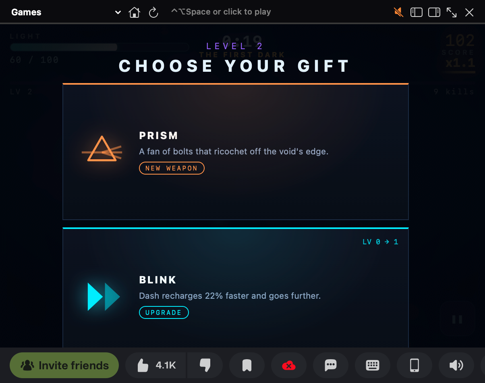

# SideQuest Arcade

**Play CrazyGames on a small screen on top of World of Warcraft — or any other game.**
Queue timers, flight paths, waiting for the raid to fill up: flip to a quick game without alt-tabbing.

## Download

| | |
|---|---|
| **Windows 10/11** (64-bit) | [SideQuest-Windows-x64.zip](https://github.com/Cristiantian/sidequest-arcade/releases/latest/download/SideQuest-Windows-x64.zip) |
| **macOS 13+** (Apple Silicon & Intel) | [SideQuest-Mac.zip](https://github.com/Cristiantian/sidequest-arcade/releases/latest/download/SideQuest-Mac.zip) |

Every version: [Releases](https://github.com/Cristiantian/sidequest-arcade/releases).

### Setup
1. **In WoW:** Options → Graphics → Display Mode → **Windowed (Fullscreen)**.
   Plain "Fullscreen" hides every overlay, including this one.
2. **Windows:** unzip and run `SideQuest.exe`. If you see "Windows protected your PC", click **More info → Run anyway** (the app isn't code-signed yet).
3. **Mac:** unzip, drag `SideQuest.app` into Applications and open it. The first time, go to **System Settings → Privacy & Security → Open Anyway** (not notarized yet).

## Hotkeys
They work while you're in WoW. **Windows: Ctrl+Alt** · **Mac: Control+Option (⌃⌥)**

| Keys | Does |
|---|---|
| **+ Space** | Swap your keyboard between the mini game and WoW (purple line = the game has it) |
| + G | Show / hide the screen |
| + ← / → | Dock left / right |
| + = / - | Bigger / smaller |
| + 1 … 9 | Jump to a game |
| + B | Browse all of CrazyGames |
| + M | Mute · + R reload |

Clicking the game also gives it the keyboard, and clicking WoW gives it back.
Drag the top bar to move it and drag the edges to resize. Opacity, games and Quit are in the tray / menu-bar icon.

Built-in games: Lumen (ours), Smash Karts, Crazy Roll 3D, Ragdoll Archers, Paper.io 2, Helix Jump, Basketball Stars,
8 Ball Billiards, Classic Solitaire. Any other CrazyGames title works through Browse.

## Is it safe for my WoW account?
It never touches WoW. SideQuest is a separate window that stays on top, the same kind of thing as
the Discord or OBS overlays. It doesn't read WoW's memory, inject anything or change game files.

## How it works
WoW addons can't show web pages, so this is not an addon. SideQuest is a small always-on-top window
with a browser view inside. It opens the real crazygames.com game page and stretches the game's own
frame to fill the window, so saves, logins and multiplayer work exactly as on the website.
A system-wide hotkey decides which window gets your keyboard.

- `mac/main.swift`: native macOS app (AppKit + WebKit, Carbon global hotkeys). Build: `./build.sh`, `./build.sh install`, `./build.sh zip`.
- `windows/`: Electron app (`main.js`, `bar.html`, `theater.js`). Run: `cd windows && npm install && npm start`. Package for Windows (works from macOS too): `npm run pack:win`.

## Credits
Made by [Shadow Games](https://shadowgames.shop). Games are hosted by [CrazyGames](https://www.crazygames.com);
SideQuest is an independent project, not affiliated with CrazyGames or Blizzard Entertainment.
World of Warcraft is a trademark of Blizzard Entertainment.

MIT License.
